<p align="center">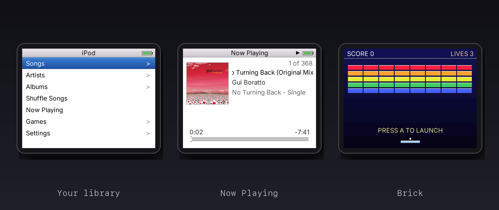</p>

# PocketTunes

An iPod-style music player for the Analogue Pocket, plus PocketTunes Sync, the Mac app that puts your music on it. On the Pocket you browse your library by album or artist, see the album art while a song plays, shuffle everything, pick a theme, and play the little games the classic iPods had: Music Quiz, Brick, Parachute and Solitaire. On the Mac, PocketTunes Sync looks like iTunes: you tick the songs you want, and it converts them, packs them with their album art into one `music.iso`, and writes it to the SD card.

<p align="center"><b>Download: <a href="https://github.com/maxsorto/pockettunes/releases">latest release</a></b><br>Analogue Pocket with openfpgaOS. Bring your own music.<br><b>Load your music: <a href="sync/">PocketTunes Sync</a> (in <code>sync/</code>)</b><br>Runs on your Mac in the browser and writes your library to the SD card.</p>

The player is a C program that runs on the openfpgaOS core, not an FPGA core of its own. No music ships with either piece.

<table>
  <tr>
    <td width="50%">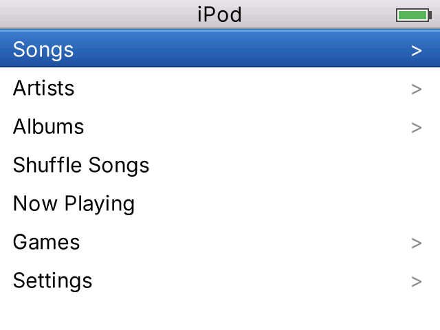</td>
    <td width="50%">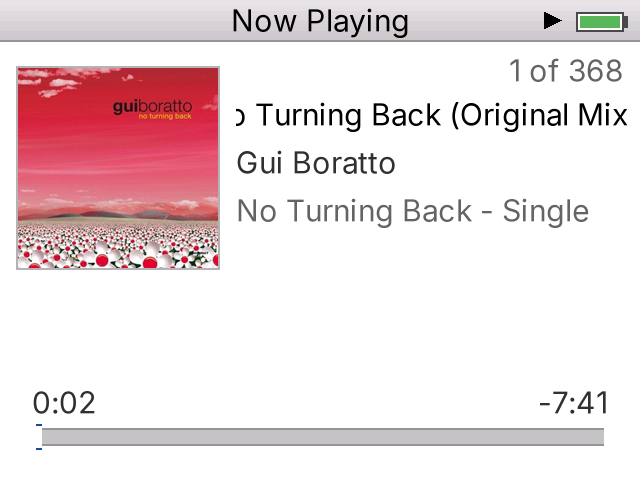</td>
  </tr>
  <tr>
    <td>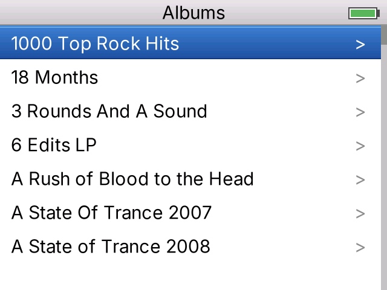</td>
    <td>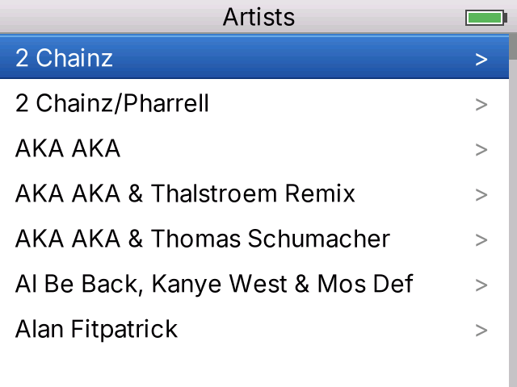</td>
  </tr>
  <tr>
    <td>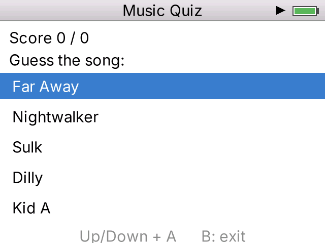</td>
    <td>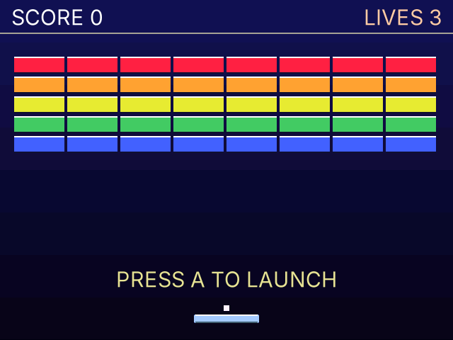</td>
  </tr>
  <tr>
    <td>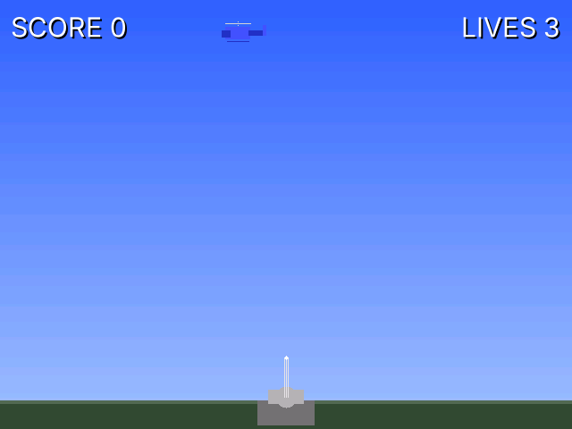</td>
    <td>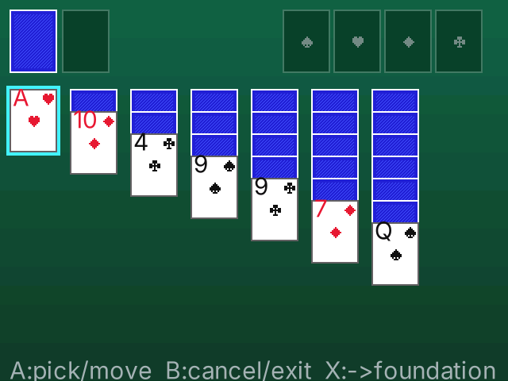</td>
  </tr>
</table>

## What's in it

| | What it does |
|---|---|
| Albums, Artists | Your library, browsed the way an iPod does it |
| Shuffle Songs | Plays the whole library in random order |
| Now Playing | Title, artist, progress and the album cover |
| Settings | Theme and volume |
| Music Quiz | Plays a clip, you guess the song. Score as you go |
| Brick | Breakout with a paddle and lives |
| Parachute | Shoot the paratroopers before they land |
| Solitaire | Klondike. A to pick and move, X sends a card to the foundation |

## Controls

D-pad to move, A to select, B to go back. In the games: A picks or fires, B exits, Start pauses and resumes.

## PocketTunes Sync

The Mac side. A local web app: a Node backend (Hono) that scans your music folder and runs ffmpeg, ffprobe, hdiutil and diskutil, and a React page that talks to it on `localhost`. It lives in [`sync/`](sync/).

<table>
  <tr>
    <td width="50%">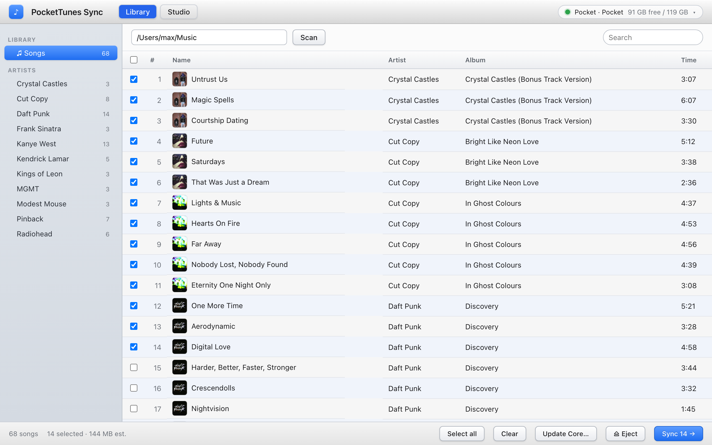</td>
    <td width="50%">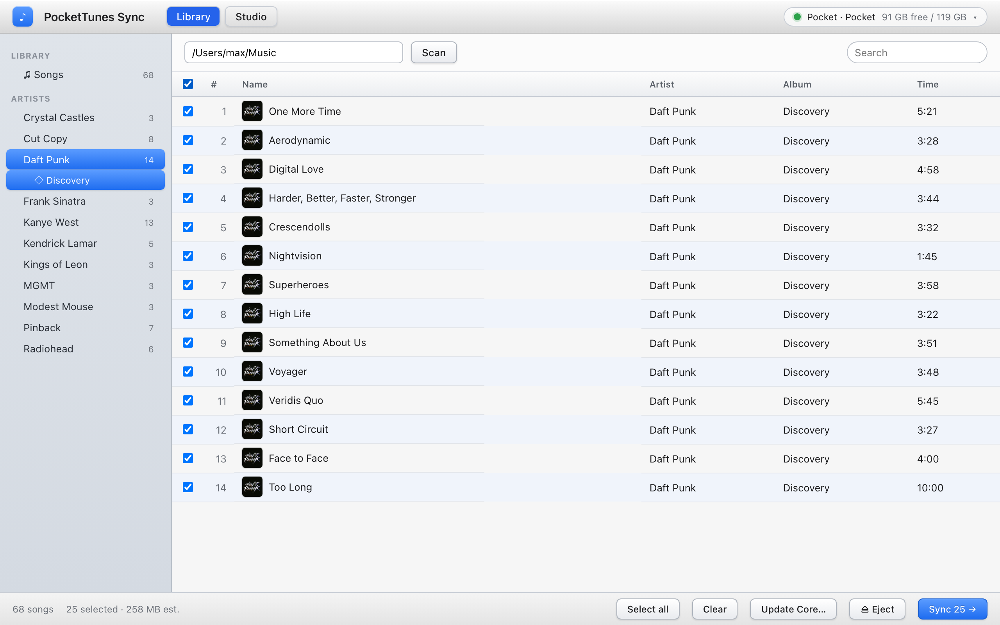</td>
  </tr>
  <tr>
    <td>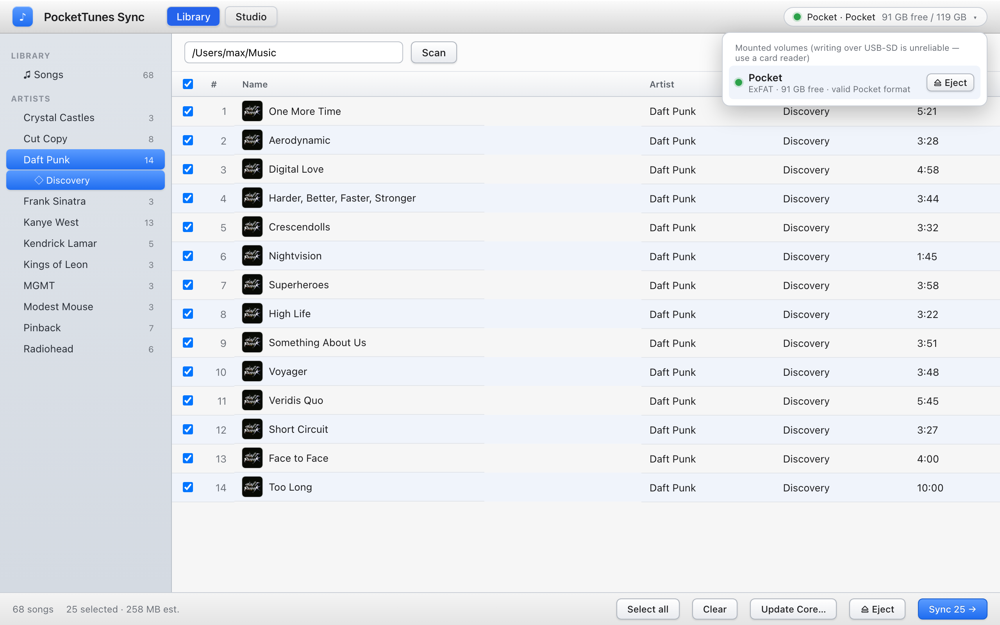</td>
    <td>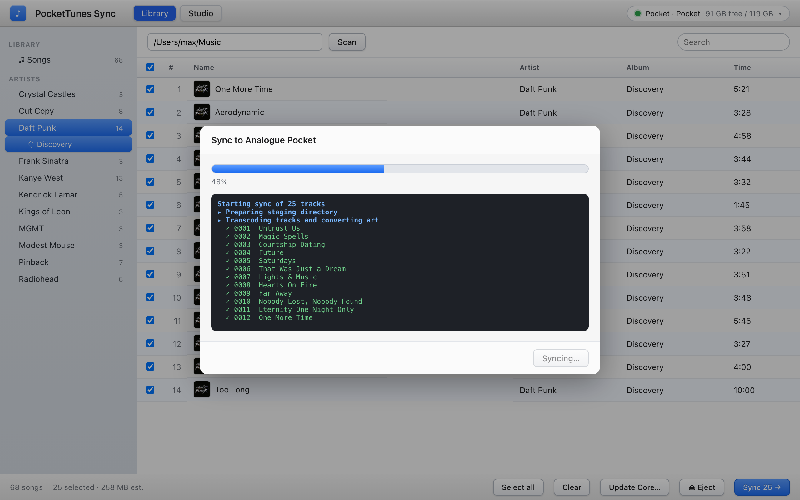</td>
  </tr>
  <tr>
    <td>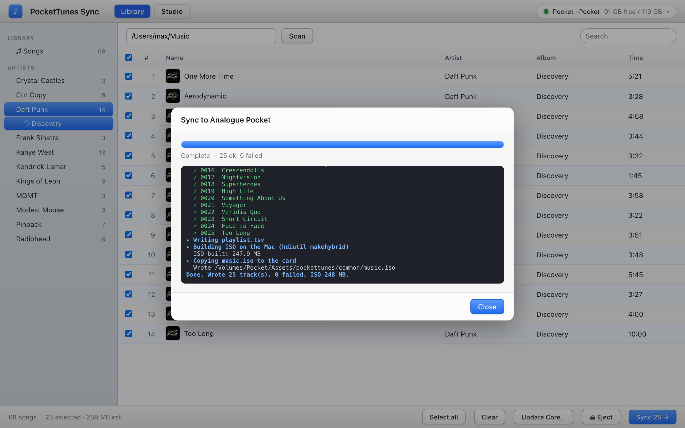</td>
    <td>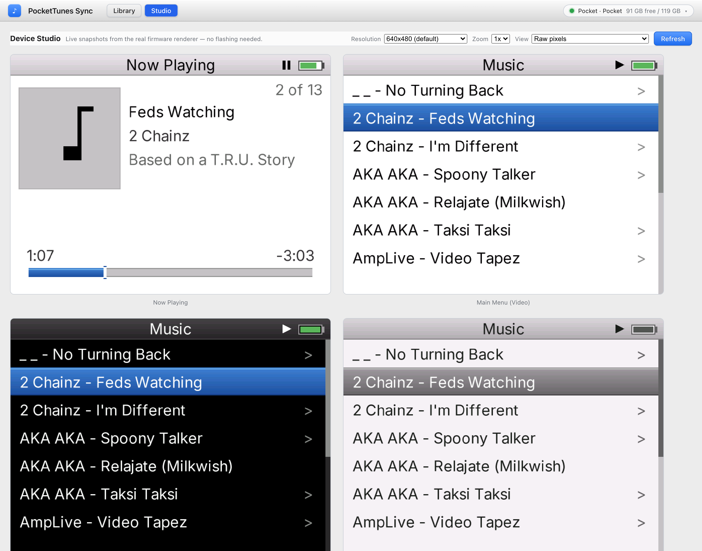</td>
  </tr>
</table>

- **Library.** Pick a folder (default `~/Music`). It reads the tags and the embedded cover of every `.m4a`, `.mp3`, `.flac`, `.aac`, `.wav` and `.alac`. DRM-protected files are flagged and skipped.
- **Card.** It finds mounted volumes and marks a card as a Pocket card when it is exFAT with `Cores/` and `Assets/` at the root. Eject is one button.
- **Sync.** The ticked songs become 48 kHz stereo MP3s and 200x200 RGB565 album art, with a `playlist.tsv`, built into one `music.iso` and copied to `/Assets/pockettunes/common/`. Progress is live, one line per track.
- **Update Core.** Copies a built PocketTunes core onto the card. It never touches `music.iso`.
- **Studio.** Draws the Pocket's screens with the real firmware UI code, so you can check a UI change without copying it to the Pocket.

Run it (needs Node 18 or newer and `brew install ffmpeg`):

```sh
cd sync
npm install
npm start     # opens http://localhost:4380
```

The screenshots above use a test folder of 68 silent MP3s tagged from a real library.

## How it works

<p align="center">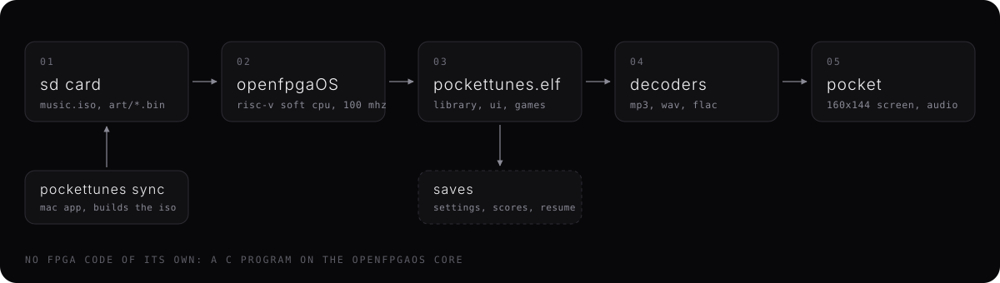</p>

- **openfpgaOS** is a RISC-V soft CPU core for the Pocket with a C SDK, a framebuffer and audio. PocketTunes is an app for it, so it gets loaded like any other openfpgaOS program.
- **The library** is one ISO 9660 image (`music.iso`) mapped into a data slot. The Pocket's file API only reads declared slots and cannot list folders, so a single image is how one app sees thousands of songs.
- **Album art** lives inside the image as `art/<album>.bin`, pre-scaled for the Pocket's screen.
- **Decoding** happens on the soft CPU: MP3 through dr_mp3, plus WAV and FLAC.
- **Saves** hold settings, game scores and where you were in the library.

## Install

1. Install openfpgaOS on the SD card (`Cores/`, `Platforms/` and its `os.bin`).
2. Copy this repository's `release/` folder onto the card root and merge the folders.
3. Load your music with PocketTunes Sync: `cd sync && npm install && npm start`. Tick the songs, pick the card, press Sync. It writes `music.iso` to `/Assets/pockettunes/common/`.
4. On the Pocket: openFPGA, PocketTunes.

## Run it locally

The same source builds for the desktop and runs in an SDL window, with a generated test library of five tracks so you don't need the Pocket or your music. On macOS:

```sh
brew install sdl2 ffmpeg
git clone --recursive git@github.com:maxsorto/pockettunes.git
cd pockettunes/firmware
make test
```

`make test` builds `build/pockettunes-desktop`, generates `testlib/` the first time, and starts the player in it. To use your own music, point it at a folder laid out like `music.iso` (`playlist.tsv`, the MP3s, `art/`), or at a mounted copy of the image itself:

```sh
hdiutil attach /path/to/music.iso          # prints the /Volumes/... it mounted at
make test MUSIC_DIR=/Volumes/<that volume>
```

Keyboard in the desktop build:

| Key | Pocket button |
|---|---|
| Arrow keys | D-pad |
| Z | A |
| X | B |
| A | X |
| Q / W | L1 / R1 |
| Return | Start |
| Right Shift | Select |

## Build for the Pocket

```sh
brew install riscv64-elf-gcc
cd firmware
make          # SD card tree in build/pocket/pockettunes/
make copy     # copy it to the Pocket's SD card (auto-detected, or SD=/Volumes/NAME)
```

`firmware/openfpgaSDK` is a submodule pinned to the openfpgaOS SDK commit the release was built against, so the `os.bin`, `os25.rbf_r` and `loader.bin` it ships match `release/` byte for byte. `make UI_SCALE=1` builds the original 320x240 look; the default is the 640x480 one.

## What's done and what's next

Done:
- Library by album and artist, shuffle, Now Playing with album art
- [PocketTunes Sync](sync/), the Mac app that builds `music.iso` and the album art and writes it to the card
- Themes and volume
- Music Quiz, Brick, Parachute and Solitaire

Next:
- Playlists and favorites
- On-the-go queue
- Click-wheel style scrolling on the d-pad

## Repository layout

- `release/` the build as it goes on the SD card: `Cores/DapperLogic.PocketTunes`, `Assets/pockettunes/`, `Platforms/pockettunes.json`
- `firmware/` the source: `src/` (player, UI, games), `Makefile`, `dist/` (core json), `openfpgaSDK/` (pinned SDK)
- `sync/` PocketTunes Sync: `server/` (Hono backend: scan, transcode, ISO, card detection, core update, Studio renderer), `web/` (Vite, React and TypeScript UI)
- `recovery/` how the source was rebuilt from the released ELF after the original was lost: decompiled reference, symbols, strings and the extraction scripts
- `docs/images/` screenshots and the diagram

## Credits and license

PocketTunes Sync is MIT licensed ([`sync/LICENSE`](sync/LICENSE)). Third-party software and trademarks are listed in [`sync/CREDITS.md`](sync/CREDITS.md). PocketTunes Sync uses Hono, Vite, React and TypeScript, and calls ffmpeg and ffprobe on your Mac. It does not ship them.

The player runs on [openfpgaOS](https://github.com/openfpgaOS/openfpgaCore) by ThinkElastic. MP3 decoding by [dr_mp3](https://github.com/mackron/dr_libs). Analogue Pocket is a trademark of Analogue. This project is not affiliated with Analogue or Apple.

No music is included or distributed. You bring your own.
